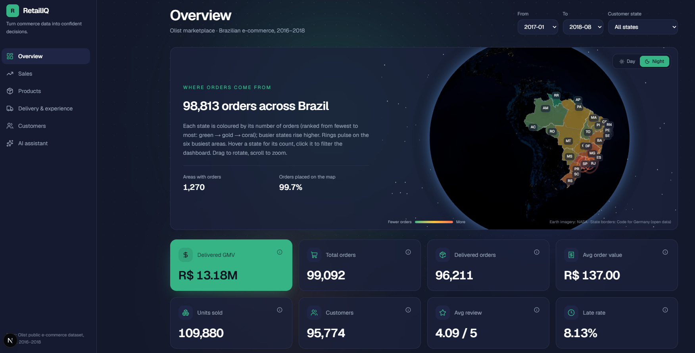
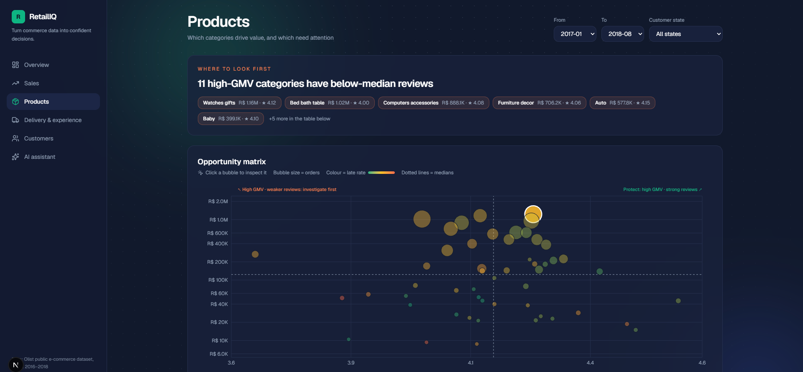
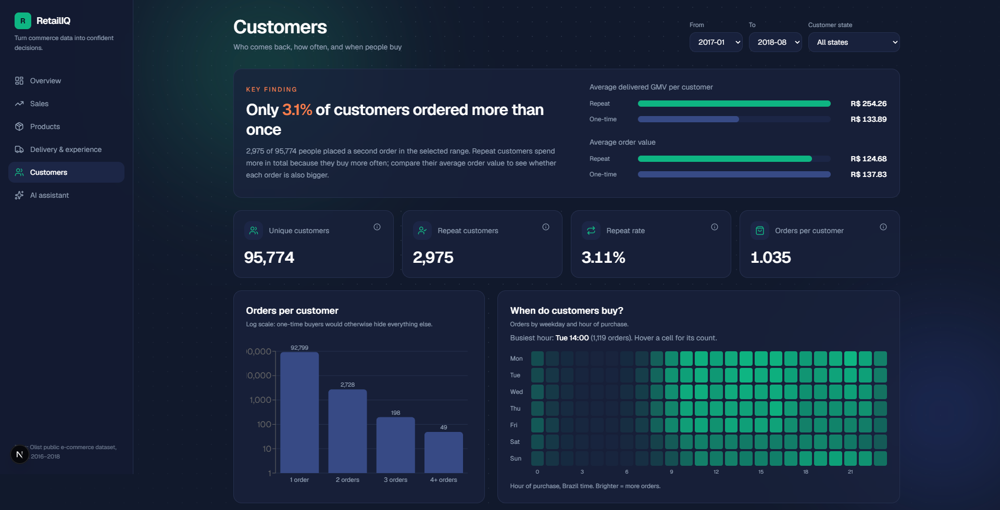
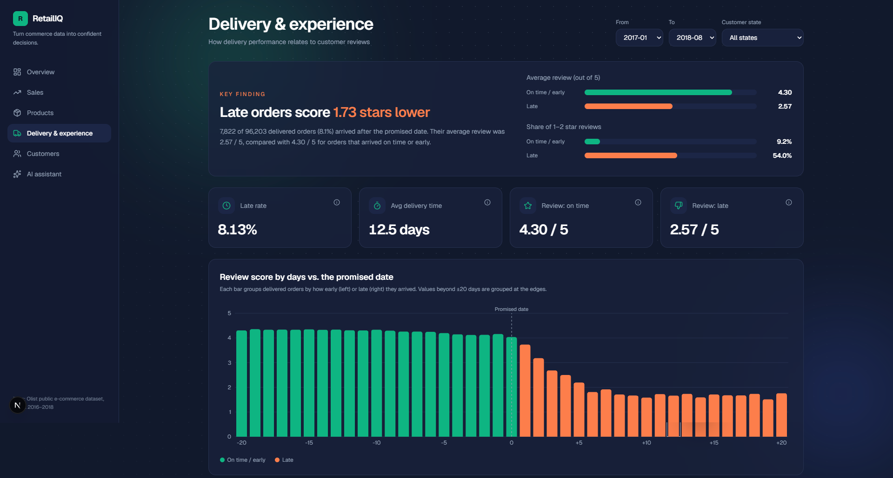
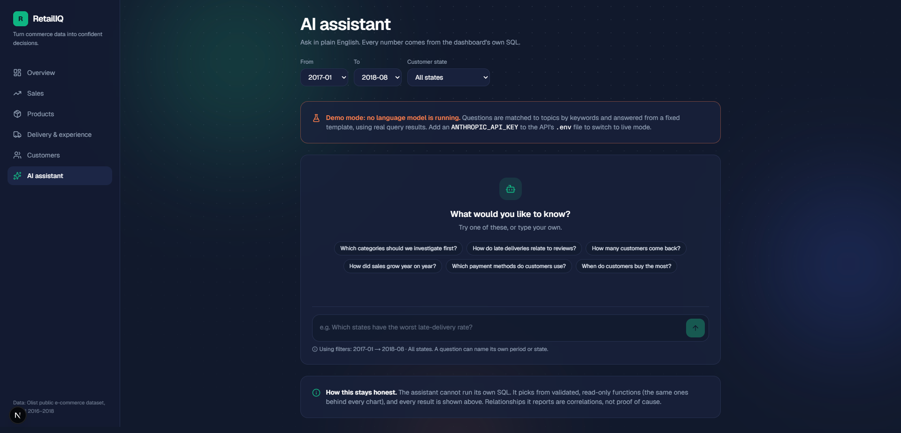
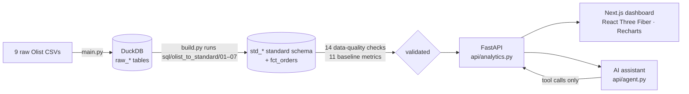

# RetailIQ

**Turn commerce data into confident decisions.**
An end-to-end e-commerce analytics product built on ~100K real orders from Olist, a Brazilian marketplace (2016–2018):
a validated SQL data model, a typed REST API, an interactive dashboard with a 3D globe, and an AI assistant that can
only answer from the same validated queries.



| | |
|---|---|
|  |  |
|  |  |

---

## What it answers

| Page | Business question | Highlights |
|---|---|---|
| **Overview** | Where do orders come from? | 3D globe with states coloured by orders; click a state to filter everything; state → city drill-down |
| **Sales** | Are we growing? | Like-for-like year-on-year growth (complete months only); month-over-month only between complete months; partial months greyed out |
| **Products** | Which categories need attention? | Opportunity matrix (GMV × review): *investigate* = high revenue, below-median reviews |
| **Delivery** | Does late delivery hurt reviews? | Review score by days early/late vs the promised date; late rate by state |
| **Customers** | Do customers come back? | Repeat rate, true monthly cohort retention with an observation window, weekday × hour heatmap |
| **AI assistant** | Ask anything in plain English | Calls 13 read-only analytics tools; every answer shows the queries and raw results behind it |

## Key findings

All figures are produced by the pipeline and checked by tests (full dataset unless stated).

- **8.11%** of delivered orders arrived after the promised date.
- Late orders average a **2.57★** review vs **4.29★** on time. This is a strong association, not proof of causation.
- Only **3.1%** of customers ordered more than once (2,975 of 95,774, Jan 2017–Aug 2018). Repeat customers spend about
  **twice as much in total** (R$ 254 vs R$ 134) but their **average order is smaller** (R$ 125 vs R$ 138): their value
  comes from frequency, not basket size.
- Monthly cohort retention stays **below 1%** in every month observed. Olist is a marketplace most people use once.
- **11 high-GMV categories** have below-median reviews (Jan 2017–Aug 2018), led by watches & gifts, bed/bath/table and
  computer accessories.
- Busiest hour: **Tuesday 14:00**. Weekdays are busier than weekends.

## Architecture



- **Layered model:** raw tables are never modified. A *standard schema* (`std_orders`, `std_order_items`, …) decouples
  the dashboard from Olist's column names, so another store's data can be mapped in later. `fct_orders` has exactly
  **one row per order**; child tables are aggregated *before* joining to prevent fan-out (double counting).
- **SQL techniques:** CTEs, window functions (`LAG` for month-over-month, `SUM() OVER ()` for shares,
  `MIN() OVER (PARTITION BY)` for cohorts), `FILTER` clauses, medians, parameterised queries.
- **API:** every filter is validated (regex for months, allow-lists for states and categories) before it reaches SQL.
  Results are cached; `NaN` becomes `null` so the JSON is always valid.

## Data quality

`build.py` stops with an error unless all 14 checks pass: one row per key in every table, no orders lost, GMV equal to
the sum of items, payments equal to the raw file, review scores between 1 and 5, and at least 99% of orders placeable
on the map. `metrics.py` then compares 11 headline numbers with a recorded baseline:

| Metric | Value |
|---|---|
| Orders | 99,441 |
| Delivered orders | 96,478 |
| Delivered merchandise GMV | R$ 13,221,498.11 |
| Delivered AOV | R$ 137.04 |
| Delivered units | 110,197 |
| Late delivery rate | 8.11% |
| Avg review: on time / late | 4.294 / 2.567 |

Definitions: **GMV** = merchandise value of delivered orders, excluding freight. **Complete months** are Jan 2017 to
Aug 2018; months outside that range are flagged as partial and never compared with complete ones. **Repeat rate**
(customers with 2+ orders in the selected range) is shown separately from **cohort retention** (customers who ordered
again *k* months after their first-ever order); cohort cells that cannot be observed yet are blank, not 0%.

## AI assistant: honest by design

- The model **cannot write SQL**. It can only call 13 validated, read-only functions, the same ones behind the charts.
  Filters it suggests are validated again.
- Every answer lists the tool calls, their filters and their raw results (“How I got this”).
- **Two clearly labelled modes:**
  - **Live** — a Claude model (default `claude-haiku-5-5`) when `ANTHROPIC_API_KEY` is set.
  - **Demo** — no key: a rule-based keyword router fills fixed templates with real query results. It is labelled
    *“rule-based, no LLM”* everywhere and is never presented as a language model.
- If the model is unreachable or rate-limited, the answer falls back to demo mode and says so.

## Run it locally

Requirements: Python 3.12+, Node 20+.

```powershell
# 1. Data: download the "Brazilian E-Commerce Public Dataset by Olist" from Kaggle
#    and put the 9 CSV files in data/raw/
git clone https://github.com/<your-username>/retailiq.git
cd retailiq
python -m venv .venv
.venv\Scripts\python.exe -m pip install -r requirements.txt

# 2. Build and validate the database
.venv\Scripts\python.exe main.py        # load CSVs into DuckDB
.venv\Scripts\python.exe build.py       # standard schema + 14 checks
.venv\Scripts\python.exe metrics.py     # 11 baseline metrics

# 3. API  (http://localhost:8000/docs)
.venv\Scripts\python.exe -m uvicorn api.main:app --reload --port 8000

# 4. Dashboard  (http://localhost:3000), in a second terminal
cd web
npm install
npm run dev
```

On Windows, `start.ps1` starts the API and the dashboard together. On macOS/Linux use `.venv/bin/python` instead.

**Optional, live AI mode:** copy `.env.example` to `.env` and set `ANTHROPIC_API_KEY`. `.env` is git-ignored; never
commit keys.

## Tests

```powershell
.venv\Scripts\python.exe -m pytest      # 30 tests
cd web; npm run build; npm run lint     # type check + lint
```

The tests check that the API reproduces the baseline metrics, that business rules hold (no month-over-month for
partial months, like-for-like year-on-year, null vs 0 in cohorts, quadrant logic), that bad input and SQL-injection
attempts are rejected, and that every number in an assistant answer comes from a tool result. Tests never call a
paid model.

## Tech stack

**Data:** DuckDB, SQL, Python, pandas · **API:** FastAPI, Pydantic, Uvicorn · **Front end:** Next.js 16, React 19,
TypeScript, Tailwind CSS 4, Framer Motion, Recharts, React Three Fiber / Drei (Three.js) · **AI:** Anthropic Claude API
with tool use · **Testing:** pytest, ESLint, TypeScript.

Accessibility: keyboard navigation, visible focus, ARIA labels, `prefers-reduced-motion` support, responsive layout
with a mobile menu and touch-friendly globe.

## Limitations

- Historical, static data (2016–2018). Not a live store.
- Olist does not publish product names, so products are identified by ID.
- Review-vs-delivery results are correlations; there is no experiment behind them.
- Map coordinates are the median of each zip-code prefix, not exact addresses.

## Credits

- Data: [Brazilian E-Commerce Public Dataset by Olist](https://www.kaggle.com/datasets/olistbr/brazilian-ecommerce)
  (CC BY-NC-SA 4.0).
- Earth imagery: NASA Visible Earth (via three-globe). State borders: Code for Germany, `click_that_hood` (open data).

Built by **Soroush Merikhy**.
